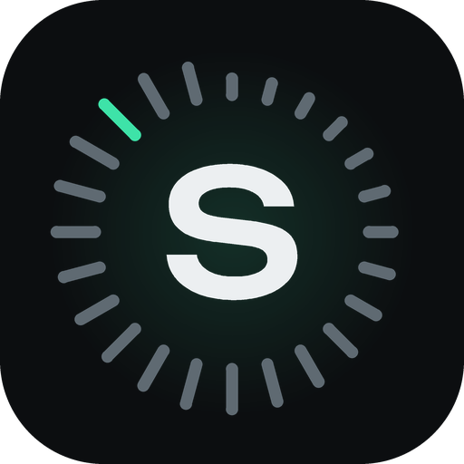
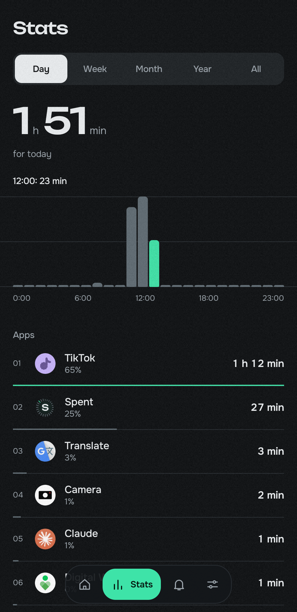
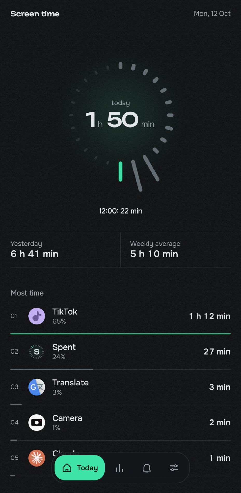
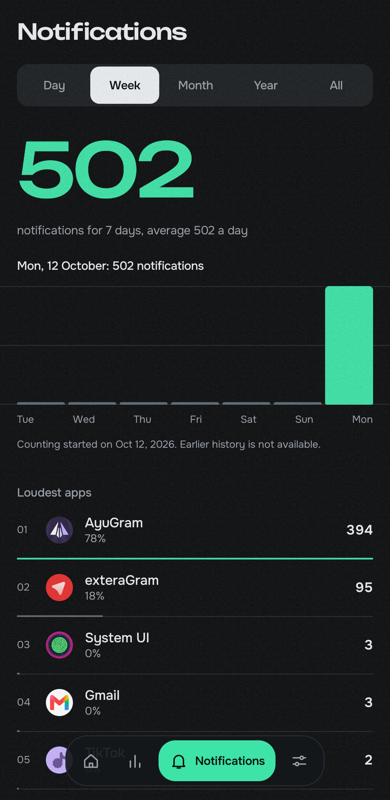
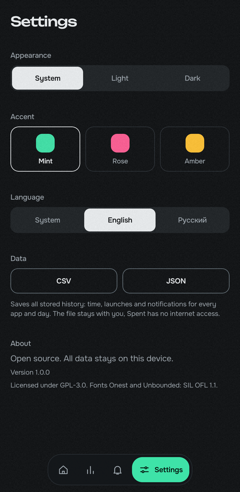

# Spent

**English** · [Русский](README.ru.md)

Private, open-source screen time tracker for Android. It shows how long you use each app and how many notifications each one sends. Everything stays on your device, and the app has no internet access at all.

  
  
  
  

## Features

- Time per app for a day, week, month, year or all time
- 24-hour dial for today
- Notification counter per app
- Per-app details: time, launches, notifications
- Export of the full history to CSV or JSON
- Light and dark themes, three accent colors
- English and Russian

## Privacy

- The app does not declare the `INTERNET` permission, so it cannot send anything anywhere. You can check it yourself: `aapt2 dump permissions app-release.apk`.
- No analytics, ads, crash reporters or other third-party SDKs.
- Notification text is never read or stored. Only the app that posted a notification and the time are counted.
- It does not request the list of all installed apps (`QUERY_ALL_PACKAGES`).
- Cloud backup is off. History moves to a new phone only through direct device-to-device transfer.
- Exports go where you choose in the system file picker.

## Permissions

Spent needs two accesses, both granted by you in system settings:

- **Usage access** (`PACKAGE_USAGE_STATS`): lets Android report time spent in apps.
- **Notification access**: lets Spent count incoming notifications.

## How the numbers work

- Android keeps detailed usage history for only about a week and coarse totals for older days. Spent saves a daily archive in a local database, so long periods work. Days that came from coarse totals are marked as approximate (dimmed bars) and have no launch counts.
- Hourly data is kept for 35 days.
- Notifications are counted from the moment access is granted. Earlier history is not available to any app.
- Spent itself and launchers are excluded from the stats.
- Aggressive battery savers (Xiaomi, Huawei and similar) can stop the notification listener. If counts look low, allow autostart and remove battery restrictions for Spent.

## Export

CSV (UTF-8 with BOM, CRLF line breaks) and JSON (`{app, format, exported_at, rows}`). One row per day and app with the columns `date, package, app, usage_ms, launches, notifications, approx`. An empty value means unknown.

## Contributing

Issues and pull requests are welcome. Privacy is the point of this project, so changes that add network access or telemetry will not be merged.

## License

[GPL-3.0](LICENSE). Fonts and libraries: see [NOTICE.md](NOTICE.md).
